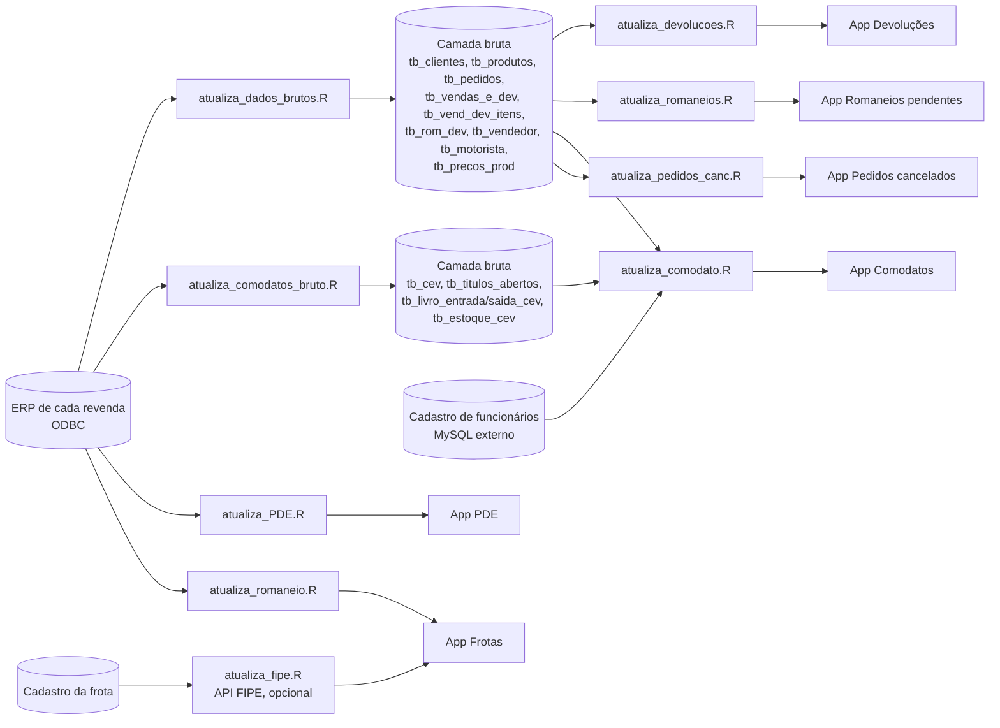

# Pipeline de dados em R — distribuidora de bebidas

Pipeline batch escrita em R para uma distribuidora de bebidas com várias revendas (filiais), cada uma com seu próprio banco no ERP. Ela rodava **de madrugada, agendada no servidor**, puxava os dados do ERP (via ODBC), montava uma **camada bruta** num MySQL/MariaDB e, a partir dela, atualizava as **tabelas lidas pelos apps Shiny em R** de acompanhamento logístico e comercial (devoluções, romaneios pendentes, comodatos, pedidos cancelados, PDE e frotas). Assim os apps abriam de manhã rápidos, lendo tabelas prontas em vez de consultar o ERP.

> **Aviso: todos os dados deste repositório são fictícios.** Revendas, CNPJs, clientes, pessoas, placas, códigos e valores foram inventados por `dados/gerar_dados_ficticios.R`. Nesta versão pública o ERP e o MySQL foram trocados por arquivos Parquet; nenhuma conexão real, host, usuário ou senha aparece no código.

Código escrito pelo autor, sem uso de IA. Para publicar, só foram trocadas as conexões (ERP/MySQL → Parquet), os dados e nomes sensíveis (→ fictícios) e as credenciais (→ `obter_credencial()`). As transformações são as originais.

## Etapas e ordem



| # | Script | Lê | Grava |
|---|--------|----|-------|
| 1 | `etapas/01_camada_bruta/atualiza_dados_brutos.R` | ERP de cada revenda: clientes, produtos, preços, vendas/devoluções, itens, pedidos, romaneios, vendedores, motoristas | `dados/bruto/tb_*` |
| 1 | `etapas/01_camada_bruta/atualiza_comodatos_bruto.R` | ERP: comodatos (CEV) pendentes, títulos em aberto, estoque do dia, livro fiscal de entrada/saída de vasilhame | `dados/bruto/tb_cev`, `tb_titulos_abertos`, `tb_livro_*_cev`, `tb_estoque_cev` |
| 2 | `etapas/02_tabelas_apps/atualiza_devolucoes.R` | camada bruta | `dados/apps/devolucoes/` — uma tabela por revenda e faixa de mês (atual, último, penúltimo, antepenúltimo, histórico) + itens |
| 2 | `etapas/02_tabelas_apps/atualiza_romaneios.R` | camada bruta | `dados/apps/romaneios_pendentes/` — romaneios em aberto, pedidos e produtos pendentes |
| 2 | `etapas/02_tabelas_apps/atualiza_comodato.R` | camada bruta + cadastro de funcionários | `dados/apps/comodatos/` — comodatos, livro fiscal, clientes inadimplentes, produtos de comodato com saldo/status, refrigeradores |
| 2 | `etapas/02_tabelas_apps/atualiza_pedidos_canc.R` | camada bruta | `dados/apps/pedidos_cancelados/` — histórico de pedidos bloqueados/cancelados (limite de CPF, mix mínimo de SKUs, bonificação sem venda) |
| 3 | `etapas/03_direto_erp/atualiza_PDE.R` | ERP: romaneios de ontem/hoje | `dados/apps/pde/tb_pde` (acrescenta) |
| 3 | `etapas/03_direto_erp/atualiza_romaneio.R` | ERP: último romaneio de cada placa | `dados/apps/frotas/tb_ult_rom` |
| 3 | `etapas/03_direto_erp/atualiza_fipe.R` | cadastro da frota + API FIPE | `dados/apps/frotas/tb_fipe_cadsen` (só roda com `FIPE_TOKEN`) |

A etapa 1 precisa rodar antes da 2; a 3 é independente. `rodar_pipeline.R` executa tudo nessa ordem.

Alguns pontos do código original que continuam aqui:

- leitura paralela das revendas com `future.apply` (cada revenda é um banco no ERP, com prefixo/dígito de tabela próprios);
- regras de negócio de reagrupamento (revendas que passaram a ser atendidas juntas, grupos por faixa de código de vendedor);
- particionamento das tabelas de devoluções por revenda e por mês, para os apps carregarem só o recorte necessário;
- saldo de vasilhame emprestado × recolhido para liberar ou bloquear novos comodatos.

## Como rodar (dados fictícios)

Requer R ≥ 4.3 e os pacotes:

```r
install.packages(c("nanoparquet", "dplyr", "tidyr", "glue", "lubridate", "stringr",
                   "stringi", "purrr", "future", "future.apply", "httr", "jsonlite", "stringdist"))
```

```bash
Rscript rodar_pipeline.R
```

Os Parquet de origem já estão em `dados/origem/`. Para recriá-los (as datas acompanham o dia em que for rodado):

```bash
Rscript dados/gerar_dados_ficticios.R
```

As saídas vão para `dados/bruto/` e `dados/apps/` (ignoradas pelo git).

## Estrutura

```
rodar_pipeline.R              # entrada: roda as etapas na ordem
R/funcoes_pipeline.R          # obter_credencial() e leitura/gravação em Parquet
etapas/01_camada_bruta/       # ERP -> camada bruta
etapas/02_tabelas_apps/       # camada bruta -> tabelas dos apps
etapas/03_direto_erp/         # ERP -> tabelas dos apps (PDE, Frotas)
dados/gerar_dados_ficticios.R
dados/origem/erp/<revenda>/   # Parquet com as colunas que cada consulta ao ERP devolvia
dados/origem/mysql/           # tabelas MySQL que não são geradas pela pipeline
```

## O que mudou na versão pública

- `dbConnect(odbc(), dsn = ...)` + `dbGetQuery(con, sql)` no ERP → `consulta_erp(banco, consulta, sql)`, que lê `dados/origem/erp/<banco>/<consulta>.parquet`. O SQL original continua no código como registro.
- `dbRemoveTable` / `dbCreateTable` / `dbAppendTable` no MySQL → `gravar_tabela()` / `anexar_tabela()` em Parquet. As consultas SQL que rodavam na camada bruta em `atualiza_comodato.R` e `atualiza_pedidos_canc.R` foram reproduzidas em dplyr (com o SQL original comentado).
- Credenciais: só a etapa da FIPE ainda precisa de uma (`FIPE_TOKEN`), obtida por `obter_credencial(nome)`. Por padrão a função lê uma variável de ambiente; é o ponto para ligar num cofre de segredos. `.Renviron.exemplo` lista só os nomes.
- Revendas, CNPJs, clientes, placas, licenças, nomes de banco e caminhos foram trocados por fictícios.
